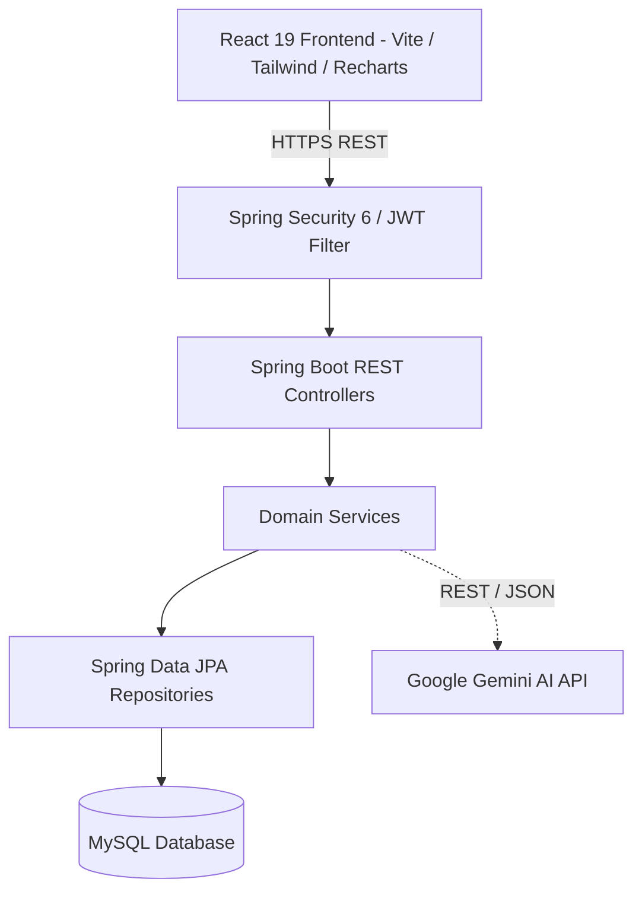

# LedgeX

> **Smart Personal Finance & Financial Wellness Platform**

LedgeX is a modern, full-stack personal finance platform designed to empower individuals with intuitive money management, intelligent budgeting, automated subscription tracking, goal setting, and personalized financial insights powered by Google Gemini AI.

---

## 📚 Repository Overview

This repository hosts the official architectural specification and Domain-Driven Design (DDD) model for the LedgeX platform:

- 📄 **[UBIQUITOUS_LANGUAGE.md](./UBIQUITOUS_LANGUAGE.md)**: Comprehensive ubiquitous language dictionary, bounded contexts, and in-depth explanation of the complete technical stack (Java 21, Spring Boot 3, React 19, Vite 8, Tailwind CSS v4, MySQL, Spring Security, and Google Gemini AI).

---

## 🛠️ Technology Stack Summary

### Backend
- **Language**: Java 21 LTS
- **Framework**: Spring Boot 3.3.5 (Spring MVC, Spring Data JPA, Spring Security 6)
- **Security**: JWT (io.jsonwebtoken 0.12.6), BCrypt Password Hashing, Stateless Filter Chain
- **Database**: MySQL 8.0+ with Hibernate 6 ORM (InnoDB, `DECIMAL(15,2)` precision)
- **External AI Integration**: Google Gemini API via Spring `RestClient` (Structured JSON Schema generation)
- **API Documentation**: Springdoc OpenAPI / Swagger UI 2.6.0
- **Build & Utilities**: Maven 3, Project Lombok

### Frontend
- **Framework**: React 19.2.6
- **Build Tool**: Vite 8.0.12
- **Styling**: Tailwind CSS v4.3.1 (`@tailwindcss/vite`)
- **State & Data Caching**: TanStack React Query v5.101.0
- **HTTP Client**: Axios 1.17.0 (with JWT interceptors)
- **Routing**: React Router DOM 7.17.0
- **Data Visualization**: Recharts 3.8.1
- **Icons & UI Feedback**: Lucide React, React Hot Toast, React Markdown

---

## 🏗️ High-Level Architecture

---

## 📖 Detailed Domain & Tech Documentation

For the full architectural breakdown, bounded contexts, mathematical formulas, domain invariants, and API standards, refer to the complete guide:

👉 **[Read UBIQUITOUS_LANGUAGE.md](./UBIQUITOUS_LANGUAGE.md)**
