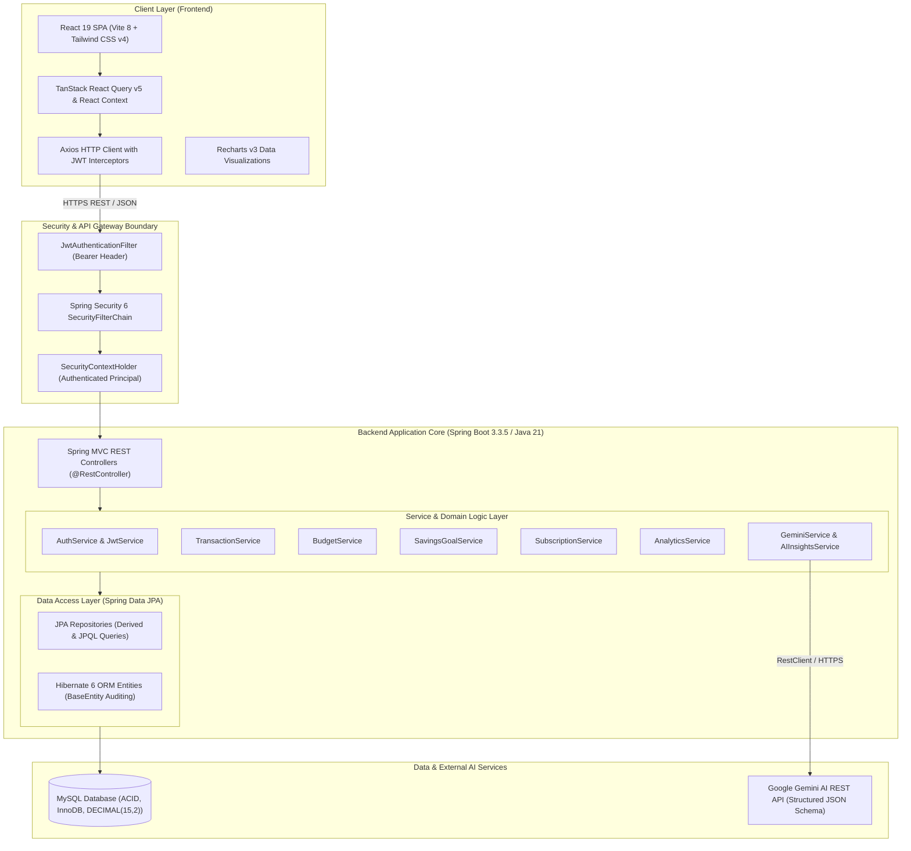
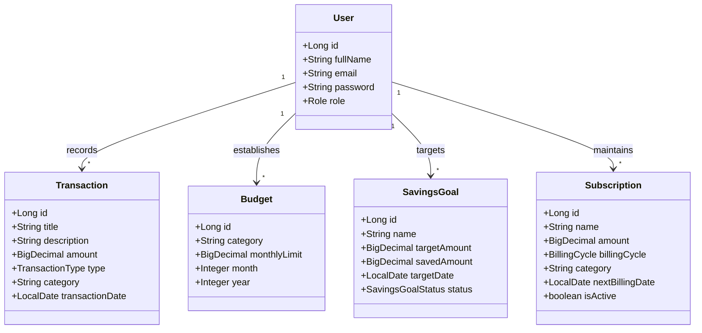

# LedgeX — Domain-Driven Design (DDD) & Ubiquitous Language Specification
## Including Comprehensive Technical Stack Architecture & Deep Dive

---

## 1. Executive Summary & Vision

**LedgeX** is an intelligent, full-stack personal finance management and financial wellness platform. It combines robust double-entry-inspired ledger tracking, granular budgeting, automated subscription monitoring, and goal-oriented savings with **context-aware AI financial coaching powered by Google Gemini**.

The system is architected around **Domain-Driven Design (DDD)** principles, separating core business capabilities into clear bounded contexts while maintaining a clean, reactive, and secure end-user experience across modern web clients.

---

## 2. Complete Technical Stack Architecture & Deep Dive

LedgeX is built on an enterprise-grade, high-performance, and type-safe polyglot architecture consisting of a **Spring Boot 3 (Java 21)** backend, a modern **React 19 / Vite 8** single-page application frontend, a **MySQL** relational database engine, and **Google Gemini Generative AI** services.



---

### 2.1 Backend Technology Stack

| Layer / Component | Technology | Version | Architectural Role & Purpose |
| :--- | :--- | :--- | :--- |
| **Language Runtime** | **Java** | `21 LTS` | Modern Java runtime taking advantage of pattern matching, switch expressions, enhanced collections, records, and virtual thread readiness. |
| **Application Framework** | **Spring Boot** | `3.3.5` | Production-ready framework providing IoC (Inversion of Control), DI (Dependency Injection), auto-configuration, and integrated application lifecycle management. |
| **Web Layer** | **Spring MVC** | `3.3.5` | RESTful API endpoint exposure using standard HTTP verbs, content negotiation, `@RestController`, and global exception handlers via `@ControllerAdvice`. |
| **Security & Auth** | **Spring Security** | `6.x` | Declarative, filter-based security engine enforcing stateless session creation (`SessionCreationPolicy.STATELESS`), CORS configuration, and endpoint authorization rules. |
| **JWT Management** | **JJWT (io.jsonwebtoken)** | `0.12.6` | Generation, signing, and verification of HMAC-SHA256 JSON Web Tokens (`jjwt-api`, `jjwt-impl`, `jjwt-jackson`). |
| **Persistence / ORM** | **Spring Data JPA / Hibernate** | `6.x` | Object-Relational Mapping, query abstraction with `JpaRepository`, transactional semantics (`@Transactional`), and optimistic locking/auditing via a common `BaseEntity`. |
| **Database Connector** | **MySQL Connector/J** | `8.x` | High-throughput JDBC driver connecting Spring Data JPA with the MySQL server. |
| **Bean Validation** | **Jakarta Validation** | `3.0` | Declarative constraint validation (`@NotNull`, `@NotBlank`, `@Positive`, `@Email`, `@Size`) at the DTO and controller boundaries. |
| **HTTP Client** | **Spring RestClient** | `Spring 6+` | Modern synchronous, fluent HTTP client used to interact with the Google Gemini AI REST API endpoints with structured request/response pipelines. |
| **API Documentation** | **Springdoc OpenAPI / Swagger UI** | `2.6.0` | Auto-generation of OpenAPI 3 specifications and interactive Swagger documentation at `/swagger-ui.html` and `/api-docs`. |
| **Boilerplate Reduction** | **Project Lombok** | `1.18.46` | Compile-time generation of getters, setters, constructors, `@Builder` design patterns, and SLF4J logging instances (`@Slf4j`). |
| **Build System** | **Apache Maven** | `3.9+` | Build automation, multi-stage compilation, dependency resolution, packaging into executable Uber-JARs via `mvnw` wrapper. |
| **Testing Suite** | **JUnit 5, Mockito, H2** | Latest | Unit and integration testing framework using in-memory H2 database for isolated repository and service verification. |

#### Backend Architecture & Design Decisions:
1. **Stateless JWT Security Architecture**:
   - Every request is intercepted by `JwtAuthenticationFilter`.
   - The token is extracted from the `Authorization: Bearer <token>` header, verified against the application secret (`app.jwt.secret`), and the subject (user email) is loaded into the `SecurityContextHolder`.
   - Passwords are encrypted using BCrypt one-way hashing with salt rounds before database persistence.
2. **Precision-First Financial Arithmetic**:
   - Currency and financial amounts strictly use Java's `java.math.BigDecimal` with `precision = 15, scale = 2` to eliminate IEEE 754 floating-point inaccuracies common with `float` or `double`.
3. **Structured Gemini AI Pipeline**:
   - Gemini requests are grounded in real-time user financial metrics (monthly income, expense aggregates, category distribution, budget overages, savings goals).
   - Gemini is commanded to respond in a strict JSON schema (`RESPONSE_SCHEMA`) containing `financialSummary`, `recommendations`, `risks`, `savingsAdvice`, and `budgetAdvice`, guaranteeing deterministic parsing into typed DTOs.

---

### 2.2 Frontend Technology Stack

| Layer / Component | Technology | Version | Architectural Role & Purpose |
| :--- | :--- | :--- | :--- |
| **UI Library** | **React** | `19.2.6` | Declarative, component-based user interface engine leveraging modern concurrent rendering and React hooks. |
| **Build & Dev Tool** | **Vite** | `8.0.12` | Next-generation frontend tooling providing lightning-fast Hot Module Replacement (HMR) and optimized Rollup-based production builds. |
| **Styling Framework** | **Tailwind CSS** | `4.3.1` | Modern utility-first CSS framework with native `@tailwindcss/vite` integration for zero-runtime styling, dynamic responsive layouts, and modern dark-mode support. |
| **State & Data Fetching** | **TanStack React Query** | `5.101.0` | Asynchronous server-state management handling caching, deduplication, background re-validation, loading indicators, and mutation side-effects. |
| **HTTP Client** | **Axios** | `1.17.0` | Configured client instance featuring request interceptors to auto-attach JWT Bearer headers and response interceptors to catch 401 Unauthorized errors for automatic logout redirection. |
| **Routing** | **React Router DOM** | `7.17.0` | Client-side routing system with route guards (`ProtectedRoute`), layout nesting, query param parsing, and programmatic navigation. |
| **Data Visualization** | **Recharts** | `3.8.1` | Composable SVG charting library providing interactive Donut/Pie charts (spending breakdown), Bar charts (budget vs actual), and Line/Area charts (income vs expense trends). |
| **Iconography** | **Lucide React** | `1.18.0` | Consistent, accessible icon set providing visual cues for financial categories, navigation menus, and actionable controls. |
| **Notifications** | **React Hot Toast** | `2.6.0` | Lightweight, customizable toast notification system for instant feedback on user actions (e.g., transaction created, budget exceeded). |
| **Markdown Rendering** | **React Markdown** | `10.1.0` | Dynamic rendering of AI-generated financial insights, formatted with bullet points, bold emphasis, and structural headings directly inside the AI Coach interface. |

#### Frontend Architecture & Design Decisions:
1. **Separation of Concerns**:
   - `/api`: Centralized API service methods abstracted away from UI components.
   - `/context`: Global application state (e.g., `AuthContext`, `ThemeContext`).
   - `/pages`: Route-level views (Dashboard, Transactions, Budgets, Subscriptions, Goals, Analytics, AI Coach).
   - `/components`: Modular, reusable atomic UI units (StatCards, Modals, CategoryBadges, Charts).
2. **Optimistic Updates & Server Cache Synchronization**:
   - TanStack React Query invalidates cached query keys (e.g., `['transactions']`, `['budgets']`, `['analytics']`) upon mutations, ensuring instant UI synchronization across views without page reloads.

---

### 2.3 Database & Storage Layer

| Component | Specification | Technical Details |
| :--- | :--- | :--- |
| **Database Engine** | **MySQL 8.0+** | Relational Database Management System (RDBMS) with InnoDB storage engine ensuring ACID compliance. |
| **Table Schema Conventions** | Snake_case naming | Tables: `users`, `transactions`, `budgets`, `savings_goals`, `subscriptions`. |
| **Monetary Columns** | `DECIMAL(15, 2)` | Ensures exact 2-decimal arithmetic up to 1 trillion units without rounding degradation. |
| **Audit Timestamps** | `created_at`, `updated_at` | Automatically populated and updated via JPA lifecycle hooks in `BaseEntity`. |
| **Compound Constraints** | `UNIQUE(user_id, category, month, year)` | Enforces business rule preventing duplicate monthly budgets for the same category per user. |

---

## 3. Ubiquitous Language Dictionary (Domain Glossary)

In Domain-Driven Design, the **Ubiquitous Language** ensures that developers, domain experts, product owners, and the codebase use the exact same terminology without ambiguity.



---

### 3.1 Identity & Access Management (IAM) Context

- **User**: The central root aggregate representing an authenticated individual utilizing the LedgeX platform. Identified uniquely by an email address.
- **Principal**: The currently authenticated user representation stored in the Spring Security context (`org.springframework.security.core.userdetails.UserDetails`).
- **Credentials**: Sensitive authentication information; passwords must be salted and hashed via BCrypt before storage. Plaintext passwords never cross service layers.
- **JSON Web Token (JWT)**: A cryptographically signed bearer token issued upon successful login, containing claims (`sub`, `issuedAt`, `expiration`) validating user identity for stateless HTTP requests.
- **Role**: Access permission tier (default `USER`). Controls authorization boundaries on secured endpoints.

---

### 3.2 Transaction Management Bounded Context

- **Transaction**: An immutable or editable record of an individual financial movement belonging to a specific User.
- **Transaction Type**:
  - `INCOME`: Positive financial inflow (e.g., Salary, Dividend, Freelance payment).
  - `EXPENSE`: Financial outflow (e.g., Groceries, Rent, Utilities, Entertainment).
- **Amount**: The monetary value of the transaction. Always stored as an unsigned positive `BigDecimal(15,2)`, whose directional sign is governed by `TransactionType`.
- **Category**: Standardized or custom classification label (e.g., `FOOD`, `HOUSING`, `ENTERTAINMENT`, `HEALTHCARE`, `INVESTMENT`, `SALARY`) used for aggregation and budget reconciliation.
- **Transaction Date**: The calendar date (`LocalDate`) when the economic activity occurred, independent of the database record creation timestamp.
- **Net Cashflow**: The sum of all `INCOME` transactions minus the sum of all `EXPENSE` transactions within a specified time window.

---

### 3.3 Budget Management Bounded Context

- **Budget**: A proactive monthly spending ceiling defined by a User for a specific Category during a given calendar Month and Year.
- **Monthly Limit**: The maximum allowable expense expenditure allocated to a category for that month.
- **Spent Amount**: The real-time aggregate of all `EXPENSE` transactions recorded within the budgeted category, month, and year.
- **Remaining Amount**: The calculated difference between `Monthly Limit` and `Spent Amount`:
  $$\text{Remaining} = \text{Monthly Limit} - \text{Spent Amount}$$
- **Budget Utilization Rate**: The percentage of the budget consumed:
  $$\text{Utilization Rate} = \left(\frac{\text{Spent Amount}}{\text{Monthly Limit}}\right) \times 100\%$$
- **Budget Overage**: The condition where $\text{Spent Amount} > \text{Monthly Limit}$. Triggers warning indicators and alerts in the AI Insights context.
- **Budget Compound Invariant**: A user cannot create more than one budget for the exact same `(user_id, category, month, year)` combination.

---

### 3.4 Savings & Goal Tracking Bounded Context

- **Savings Goal**: A targeted financial milestone defined by a user with a specific monetary objective and target completion date.
- **Target Amount**: The cumulative financial sum required to fulfill the goal.
- **Saved Amount**: The current sum allocated or deposited toward the goal to date.
- **Target Date**: The scheduled date by which the user aims to complete the goal.
- **Savings Goal Status**:
  - `IN_PROGRESS`: The goal is active and actively receiving contributions.
  - `COMPLETED`: $\text{Saved Amount} \ge \text{Target Amount}$.
  - `CANCELLED`: The goal has been abandoned or marked inactive by the user.
- **Goal Progress Percentage**:
  $$\text{Progress Rate} = \min\left(100\%, \left(\frac{\text{Saved Amount}}{\text{Target Amount}}\right) \times 100\%\right)$$

---

### 3.5 Subscription Management Bounded Context

- **Subscription**: A recurring financial obligation or periodic service charge (e.g., Netflix, Spotify, Gym, Cloud Hosting).
- **Billing Cycle**: The recurrence cadence of the subscription payment:
  - `DAILY`: Charges every day.
  - `WEEKLY`: Charges every 7 days.
  - `MONTHLY`: Charges once per calendar month.
  - `YEARLY`: Charges once per annum.
- **Next Billing Date**: The calendar date when the subsequent debit is scheduled to occur.
- **Active State (`isActive`)**: Boolean flag indicating whether the subscription is currently active or has been cancelled/paused.
- **Monthly Burn Rate**: The normalized monthly cost of all active subscriptions:
  $$\text{Normalized Monthly Cost} = \begin{cases} \text{Amount} \times 30 & \text{if DAILY} \\ \text{Amount} \times 4.33 & \text{if WEEKLY} \\ \text{Amount} & \text{if MONTHLY} \\ \text{Amount} / 12 & \text{if YEARLY} \end{cases}$$

---

### 3.6 Analytics & Financial Health Bounded Context

- **Overview Analytics**: High-level key performance indicators (KPIs) aggregated over a selected monthly or annual period:
  - Total Income
  - Total Expenses
  - Net Savings
  - Active Subscriptions Count
- **Financial Health Score**: An algorithmic score (0 to 100) assessing the user's financial stability based on weighted factors:
  - Savings Rate factor (Weight: 35%)
  - Budget Adherence factor (Weight: 35%)
  - Debt / Expense Ratio factor (Weight: 20%)
  - Subscription Load factor (Weight: 10%)
- **Health Rating**: Discrete evaluation tier derived from the Health Score:
  - `EXCELLENT` ($80 - 100$)
  - `GOOD` ($65 - 79$)
  - `FAIR` ($50 - 64$)
  - `POOR` ($0 - 49$)
- **Category Spending Distribution**: Relative percentage breakdown of spending across all active categories, rendered via Recharts Donut visualizations.
- **Monthly Spending Trends**: Longitudinal comparison of income vs. expenses across historical months.
- **Budget vs. Actual Variance**: Direct comparison showing allocated budget caps alongside true transaction totals.

---

### 3.7 AI Financial Advisory & Intelligence Context (Gemini)

- **AI Financial Coach**: An intelligent conversational agent that provides tailored, context-aware financial guidance without giving formal legal/tax advice.
- **Financial Context Grounding**: The automated aggregation of the user's current month income, expense breakdown, budget utilization, active subscriptions, and goals injected directly into the Gemini prompt payload.
- **Deterministic Structured Output**: Prompt engineering and API schemas enforcing that Gemini outputs strict JSON matching the `RESPONSE_SCHEMA`:
  - `financialSummary`: Executive narrative of user's financial condition.
  - `recommendations`: Concrete, prioritized behavioral optimizations.
  - `risks`: Immediate or projected financial red flags (e.g., overspending, depleted runway).
  - `savingsAdvice`: Tactics to accelerate active savings goals.
  - `budgetAdvice`: Suggested adjustments to category thresholds.
- **Conversational Assistant (Chat)**: Multi-turn dialogue enabling users to ask ad-hoc questions (e.g., *"Can I afford a \$1,200 laptop this month?"*) with real-time computation against user cash balances.

---

## 4. Domain Invariants & Business Rules

1. **Monetary Non-Negativity**:
   - `Transaction.amount` must always be strictly $> 0$.
   - `Budget.monthlyLimit` must always be $\ge 0$.
   - `SavingsGoal.targetAmount` must be $> 0$; `savedAmount` must be $\ge 0$.
2. **Compound Budget Uniqueness**:
   - A user can only define a single budget for a given category in a specific month and year (`@UniqueConstraint(columnNames = {"user_id", "category", "month", "year"})`).
3. **User Isolation (Multi-Tenancy Rule)**:
   - All queries, mutations, aggregations, and AI prompt assemblies must be scoped strictly to the authenticated `User.id` derived from the validated JWT token. Cross-tenant leakage is strictly prevented.
4. **AI Safety & Privacy Guard**:
   - Only aggregated financial figures (totals, categories, counts) are transmitted to the Gemini API. Personal Identifiable Information (PII) such as full names, email addresses, and account numbers are scrubbed from LLM payloads.

---

## 5. API Design Conventions

All endpoints adhere to standardized RESTful URI conventions:

```http
# Authentication
POST /api/v1/auth/register       -> Register a new user
POST /api/v1/auth/login          -> Authenticate and obtain JWT Bearer token

# Transactions
GET    /api/v1/transactions      -> Query filtered transactions (pageable, category, date)
POST   /api/v1/transactions      -> Record a new transaction
PUT    /api/v1/transactions/{id} -> Update existing transaction
DELETE /api/v1/transactions/{id} -> Remove transaction

# Budgets
GET    /api/v1/budgets           -> Retrieve active monthly budgets
POST   /api/v1/budgets           -> Set budget for category
DELETE /api/v1/budgets/{id}      -> Delete budget allocation

# Savings Goals
GET    /api/v1/savings           -> List all goals with progress
POST   /api/v1/savings           -> Create a savings target
PUT    /api/v1/savings/{id}      -> Update goal progress or status

# Subscriptions
GET    /api/v1/subscriptions     -> List active recurring subscriptions
POST   /api/v1/subscriptions     -> Register new subscription
PUT    /api/v1/subscriptions/{id}-> Update billing cycle / status

# Analytics & AI
GET    /api/v1/analytics/overview-> Financial health score & KPI summaries
GET    /api/v1/ai/insights       -> Structured AI analysis & recommendations
POST   /api/v1/ai/chat           -> Conversational financial coaching
```

---

*LedgeX Documentation — Maintained by the LedgeX Core Architecture Team.*
