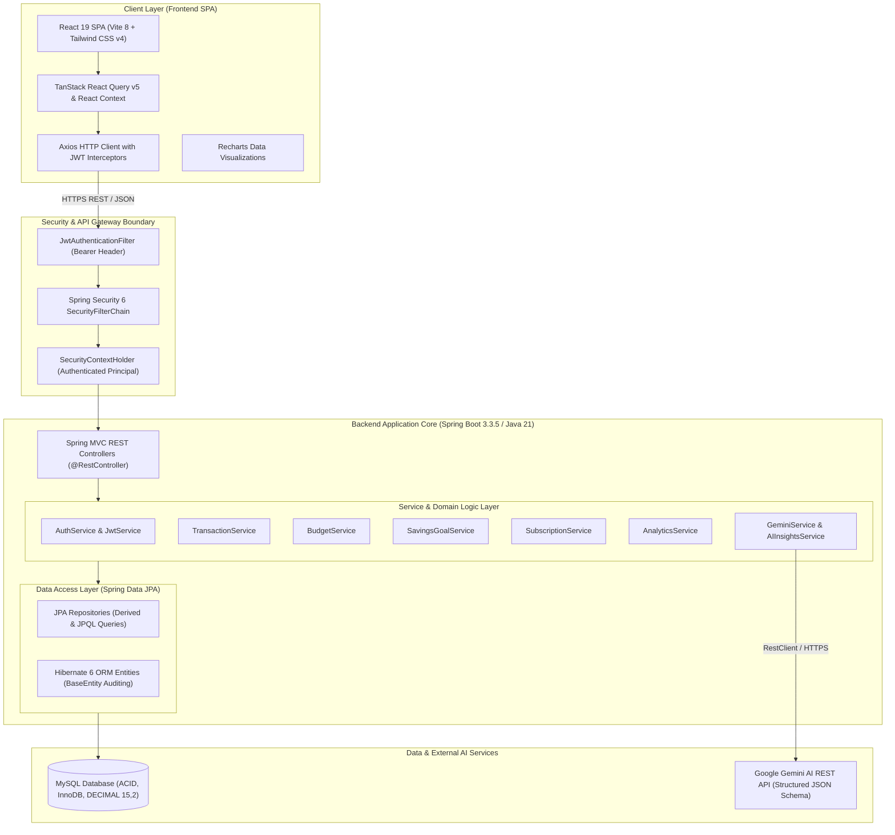
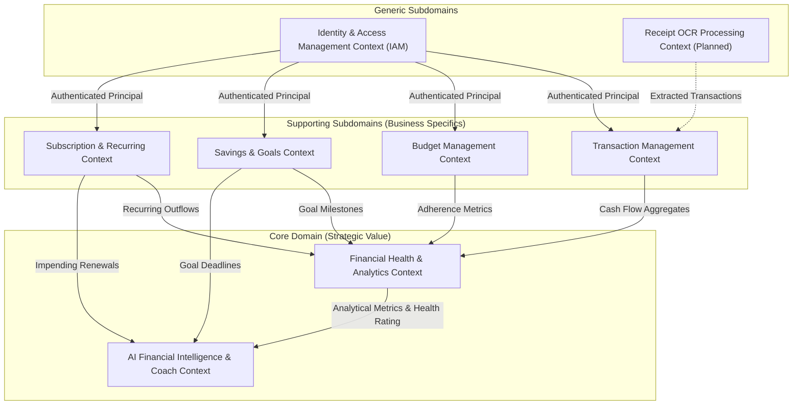
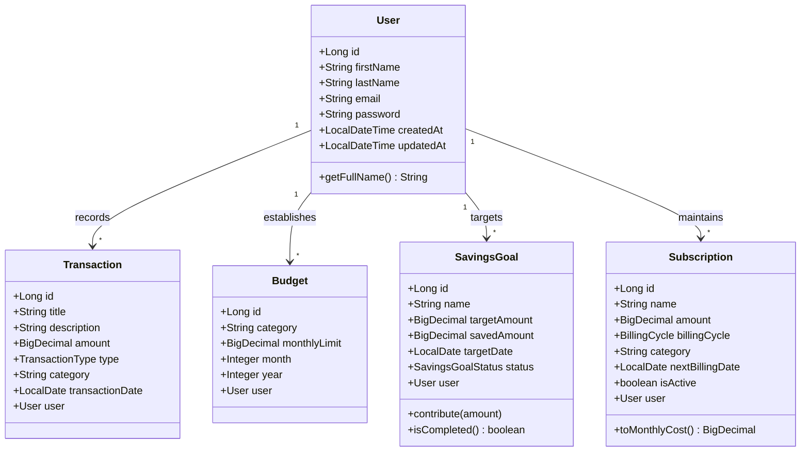
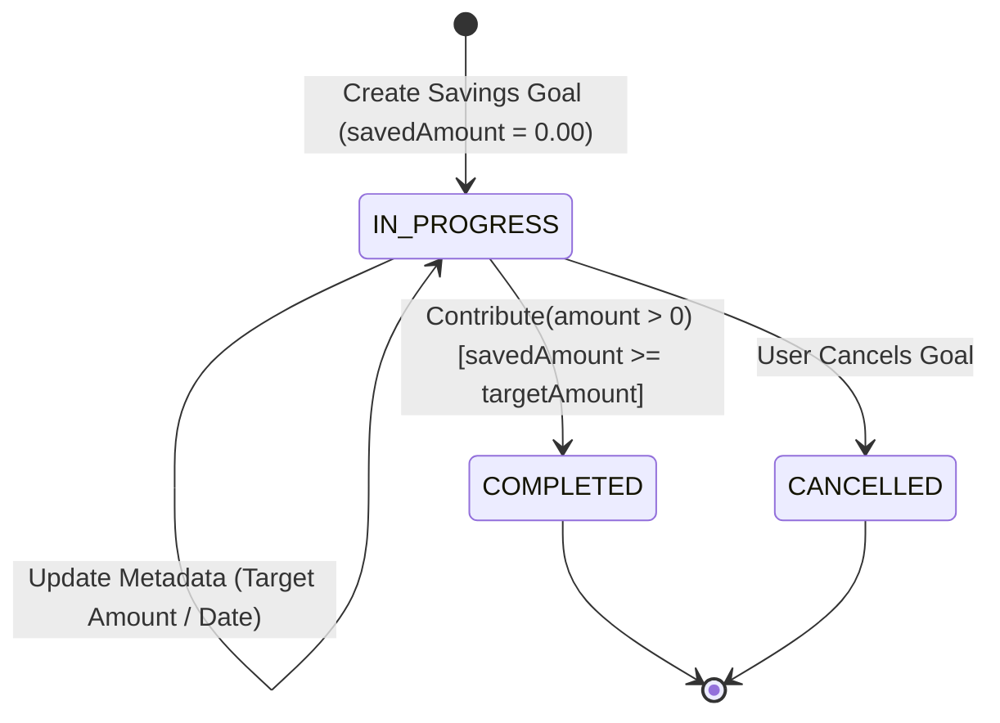

# LedgeX — Domain-Driven Design (DDD) & Ubiquitous Language Specification
## Including Comprehensive Technical Stack Architecture, Domain Model, and System Glossary

> **Document Type:** Authoritative Technical Architecture & DDD Ubiquitous Language Specification  
> **System Name:** LedgeX (Smart Personal Finance & Financial Wellness Platform)  
> **Target Audience:** Software Engineers, System Architects, Product Managers, QA Engineers, Domain Experts, and AI Agents  
> **Repository Location:** `LedgeX/UBIQUITOUS_LANGUAGE.md`  
> **Status:** Living Master Specification  

---

## 1. Executive Summary & Domain Vision

**LedgeX** is an enterprise-grade, intelligent personal finance management and financial wellness platform. It unifies ledger-based bookkeeping, proactive categorical budgeting, milestone-driven capital accumulation, and automated subscription tracking with **context-aware AI financial coaching powered by Google Gemini**.

The platform is designed to transition users from passive expense recording to active, actionable financial wellness. By anchoring system components in **Domain-Driven Design (DDD)** principles, LedgeX separates business capabilities into strictly isolated Bounded Contexts while delivering a type-safe, reactive, and secure user experience across modern web interfaces.

The **Ubiquitous Language** formalized herein serves as the single source of truth across all product requirements, UI/UX terminology, REST API contracts, database schemas, and application source code.

---

## 2. Technical Stack Architecture & Deep Dive

LedgeX utilizes an enterprise-grade, polyglot architecture composed of a **Spring Boot 3 (Java 21 LTS)** backend, a **React 19 / Vite 8** single-page application frontend, a **MySQL 8.0+** relational persistence engine, and **Google Gemini Generative AI** services.



---

### 2.1 Backend Technology Stack

| Layer / Component | Technology | Version | Architectural Role & Purpose |
| :--- | :--- | :--- | :--- |
| **Language Runtime** | **Java** | `21 LTS` | High-throughput LTS runtime leveraging pattern matching, switch expressions, records, and virtual thread readiness. |
| **Application Framework** | **Spring Boot** | `3.3.5` | Production-ready framework providing IoC (Inversion of Control), DI (Dependency Injection), and auto-configuration. |
| **Web Layer** | **Spring MVC** | `3.3.5` | RESTful API endpoints utilizing content negotiation, `@RestController`, and global `@ControllerAdvice` error handling. |
| **Security Engine** | **Spring Security** | `6.x` | Stateless session management (`SessionCreationPolicy.STATELESS`), CORS filter configuration, and route authorization. |
| **JWT Management** | **JJWT (io.jsonwebtoken)** | `0.12.6` | Generation, parsing, and cryptographic verification of HMAC-SHA256 JSON Web Tokens (`jjwt-api`, `jjwt-impl`, `jjwt-jackson`). |
| **Persistence / ORM** | **Spring Data JPA / Hibernate** | `6.x` | Object-Relational Mapping, query abstraction via `JpaRepository`, transactional semantics (`@Transactional`), and JPA auditing via `BaseEntity`. |
| **Database Connector** | **MySQL Connector/J** | `8.x` | High-performance JDBC driver establishing pool connections with the MySQL engine. |
| **Bean Validation** | **Jakarta Validation** | `3.0` | Declarative constraint enforcement (`@NotNull`, `@NotBlank`, `@Positive`, `@Email`, `@Size`) at controller and DTO boundaries. |
| **HTTP Client** | **Spring RestClient** | `Spring 6+` | Modern synchronous, fluent HTTP client managing structured JSON request/response exchanges with Google Gemini AI. |
| **API Documentation** | **Springdoc OpenAPI / Swagger UI**| `2.6.0` | Automated generation of OpenAPI 3 specifications available via `/swagger-ui.html` and `/api-docs`. |
| **Boilerplate Reduction** | **Project Lombok** | `1.18.46` | Compile-time generation of accessors, mutators, constructors, builders (`@Builder`), and SLF4J loggers (`@Slf4j`). |
| **Build Automation** | **Apache Maven** | `3.9+` | Build lifecycle management, dependency resolution, and packaging executable Uber-JARs via the `mvnw` wrapper. |
| **Testing Suite** | **JUnit 5, Mockito, H2** | Latest | Unit and integration test suite executing isolated domain service and repository tests against an in-memory database. |

#### Backend Architecture & Engineering Decisions:
1. **Stateless JWT Security Architecture**:
   - Every inbound request is evaluated by `JwtAuthenticationFilter`.
   - The token is extracted from the `Authorization: Bearer <token>` header, verified against `app.jwt.secret`, and the user identity (`email`) is established in the `SecurityContextHolder`.
   - Passwords are encrypted using BCrypt one-way adaptive hashing with auto-generated salts prior to database persistence.
2. **Precision-First Financial Arithmetic**:
   - Currency amounts strictly use `java.math.BigDecimal` with `precision = 15, scale = 2` to eliminate IEEE 754 floating-point inaccuracies inherent in `float` or `double`.
   - All divisions apply `RoundingMode.HALF_UP`.
3. **Structured Gemini AI Pipeline**:
   - Outbound LLM requests are grounded in real-time user financial context (income, expense aggregates, category distribution, budget utilization, savings goals, active subscriptions).
   - Gemini responses are enforced via a JSON schema (`RESPONSE_SCHEMA`) returning structured fields (`financialSummary`, `recommendations`, `risks`, `savingsAdvice`, `budgetAdvice`).

---

### 2.2 Frontend Technology Stack

| Layer / Component | Technology | Version | Architectural Role & Purpose |
| :--- | :--- | :--- | :--- |
| **UI Library** | **React** | `19.2.6` | Declarative, component-driven user interface engine leveraging React hooks and concurrent rendering. |
| **Build & Dev Tool** | **Vite** | `8.0.12` | Next-generation frontend toolchain featuring fast Hot Module Replacement (HMR) and Rollup-based production bundling. |
| **Styling Framework** | **Tailwind CSS** | `4.3.1` | Utility-first CSS engine with native `@tailwindcss/vite` integration for zero-runtime styling, theme tokens, and dark mode. |
| **State & Server Cache**| **TanStack React Query** | `5.101.0` | Server-state management handling caching, deduplication, background synchronization, and optimistic mutation side-effects. |
| **HTTP Client** | **Axios** | `1.17.0` | Interceptor-enabled HTTP client auto-injecting JWT Bearer headers and trapping 401 Unauthorized responses for auto-logout. |
| **Client Routing** | **React Router DOM** | `7.17.0` | Declarative client-side routing featuring route guards (`ProtectedRoute`), layout nesting, and URL state synchronizations. |
| **Data Visualization** | **Recharts** | `3.8.1` | Composable SVG chart components (Pie/Donut category distribution, Bar budget vs. actual comparisons, Area monthly cashflow trends). |
| **Iconography** | **Lucide React** | `1.18.0` | Accessible, unified iconography representing categories, statuses, navigation elements, and alerts. |
| **Notifications** | **React Hot Toast** | `2.6.0` | Non-blocking toast notification library delivering instantaneous feedback on mutations and errors. |
| **Markdown Rendering** | **React Markdown** | `10.1.0` | Safe rendering of AI Financial Coach markdown responses (bullet lists, emphasis, and structural headings). |

#### Frontend Architecture & Engineering Decisions:
1. **Modular Directory Structure**:
   - `/api`: Centralized HTTP clients and service methods decoupled from visual components.
   - `/context`: Global state providers (`AuthContext`, `ThemeContext`).
   - `/pages`: Route-level container components (Dashboard, Transactions, Budgets, Subscriptions, Goals, Analytics, AI Coach).
   - `/components`: Atomic, reusable UI elements (PageHeader, ProtectedRoute, Modals, Badges, Charts).
2. **Server-Cache Synchronization**:
   - Queries are cached under semantic keys (e.g., `['transactions']`, `['budgets']`, `['analytics']`). Data-mutating operations trigger cache invalidation to maintain UI consistency across views without hard page reloads.

---

### 2.3 Database & Storage Layer

| Component | Specification | Technical Details |
| :--- | :--- | :--- |
| **Database Engine** | **MySQL 8.0+** | Relational Database Management System (RDBMS) configured with the ACID-compliant InnoDB storage engine. |
| **Naming Conventions** | Snake_case tables & columns | Tables: `users`, `transactions`, `budgets`, `savings_goals`, `subscriptions`. |
| **Monetary Columns** | `DECIMAL(15, 2)` | Guarantees exact 2-decimal fractional precision for monetary figures up to 1 trillion units. |
| **Audit Timestamps** | `created_at`, `updated_at` | Automatically generated and maintained through JPA lifecycle listeners (`AuditingEntityListener`) on `BaseEntity`. |
| **Compound Constraints** | `UNIQUE(user_id, category, month, year)` | Enforces business rule preventing duplicate category budgets within the same calendar month for a user. |

---

## 3. Domain-Driven Design (DDD) Strategic Architecture

### 3.1 Bounded Context Map & Subdomain Classification

LedgeX decomposes its problem space into strategic subdomains, separating core business differentiators from supporting mechanisms:



| Subdomain | Classification | Strategic Value & Justification |
| :--- | :--- | :--- |
| **Financial Health & Analytics** | **Core Domain** | Proprietary multi-factor scoring model that rates personal fiscal wellness (0–100 scale) using weighted heuristics. |
| **AI Financial Intelligence** | **Core Domain** | Context-grounded LLM reasoning engine translating mathematical ledger states into actionable conversational coaching. |
| **Transaction Management** | **Supporting Domain** | Core ledger tracking cash movements with standardized category taxonomy and date filtering. |
| **Budget Management** | **Supporting Domain** | Monthly categorical spending limits with real-time utilization and overrun alerts. |
| **Savings & Goals** | **Supporting Domain** | Forward-looking capital targets with progress tracking and auto-completion state transitions. |
| **Subscription Management** | **Supporting Domain** | Tracking periodic recurring obligations, normalization of monthly burn rate, and renewal alerts. |
| **Identity & Access Management** | **Generic Subdomain** | Standard stateless JWT authentication, password hashing, and user credential lifecycle. |
| **Receipt OCR & Scanning** | **Generic Subdomain (Planned)** | Computer vision extraction pipeline parsing physical paper receipts into structured transaction drafts. |

---

### 3.2 Domain Model Class Diagram



---

## 4. Global Domain Invariants, Value Types & Conventions

### 4.1 Currency & Precision Standards
- **Canonical Currency:** Indian Rupee (**INR** / **₹**).
- **Backend Representation:** `java.math.BigDecimal` with `precision = 15, scale = 2`.
- **Rounding Mode:** `RoundingMode.HALF_UP` for all calculations (utilization ratios, monthly costs, scoring weights).
- **Floating-Point Ban:** Raw primitives (`float`, `double`) are **strictly forbidden** for monetary figures.
- **Frontend Presentation:** Formatted via the Indian numbering format standard `en-IN` (e.g., `₹1,50,000.00`).

### 4.2 Temporal Standards
- **Temporal Zone:** Universal Time Coordinated (`UTC`) storage in database; localized rendering in client browser.
- **Accounting Period:** Calendar month (`1` through `12`) and full calendar year (e.g., `2026`).
- **Entity Timestamping:** All aggregates inherit immutable `createdAt` and mutable `updatedAt` audit timestamps via JPA auditing.

### 4.3 Multi-Tenancy & User Isolation
- **Tenant Isolation:** Every primary aggregate (`Transaction`, `Budget`, `SavingsGoal`, `Subscription`) is strictly owned by a single `User`.
- **Boundary Invariant:** All queries, mutations, aggregations, and AI prompt assemblies must be scoped strictly to the authenticated `User.id` derived from the validated JWT token. Cross-tenant reads or cross-user data leakage are strictly prevented.

---

## 5. Ubiquitous Language Dictionary by Bounded Context

---

### Context 1: Identity & Access Management (IAM)

The IAM context manages security principals, identity registration, session establishment, and access token verification.

| Domain Term | Technical Name | Representation | Definition & Domain Invariant | Disallowed Synonyms (Do NOT Use) |
| :--- | :--- | :--- | :--- | :--- |
| **User** | `User` | Entity / JPA Aggregate | A registered individual who maintains private financial records in LedgeX. Identified uniquely by an email address. | Account, Client, Customer, Profile, Member |
| **User Email** | `email` | String (Value Object) | The unique digital identity and username for authentication. Must conform to RFC 5322 email formatting. | Username, Login ID, Handle |
| **Password Credential**| `password` | Hashed String | BCrypt-hashed representation of the user's secret pass-phrase. Plaintext passwords must never persist or appear in logs. | Passcode, Pin, Secret |
| **First Name** / **Last Name** | `firstName`, `lastName` | String Pair | The legal or chosen names of the user. `firstName` is used as the conversational greeting token by the AI Coach. | Nickname, Display Name |
| **Full Name** | Computed property | String | The concatenated representation: `${firstName} ${lastName}`. Used for UI headers and account settings. | Screen Name, User Label |
| **JWT Access Token** | `token` / `JwtService` | Signed Bearer Token | Cryptographically signed, stateless claim containing the subject (`email`), issue timestamp, and expiration period (default: 24 hours / 86,400,000 ms). | Session ID, API Key, Cookie |
| **Authentication Principal**| `UserDetails` | Spring Security Principal | The currently authenticated user context extracted from the HTTP `Authorization: Bearer <token>` header on each API call. | Current User, Session User |
| **Role** | GrantedAuthority | String / Enum | Access authorization level (default: `USER`). Governs route access permissions. | Permission Group, Tier |

---

### Context 2: Transaction Management Bounded Context

The operational core recording all historical financial occurrences (inflows and outflows).

| Domain Term | Technical Name | Representation | Definition & Domain Invariant | Disallowed Synonyms (Do NOT Use) |
| :--- | :--- | :--- | :--- | :--- |
| **Transaction** | `Transaction` | Entity / JPA Aggregate | An auditable single financial occurrence on a specific date representing money moving into or out of the user's possession. | Entry, Item, Ledger Record, Charge |
| **Transaction Title** | `title` | String (1–255 chars) | A concise, human-readable label identifying the counterparty, vendor, or source (e.g., "Monthly Salary", "Swiggy", "Amazon"). | Subject, Headline, Label |
| **Transaction Description** | `description` | String (nullable, max 500) | Optional contextual notes or metadata elaborating on the transaction purpose. | Memo, Note, Details |
| **Transaction Amount** | `amount` | `BigDecimal(15,2)` | The monetary value of the transaction. Must always be strictly positive ($> 0.00$). The direction of flow is dictated exclusively by `TransactionType`. | Cost, Price, Size, Value |
| **Transaction Type** | `TransactionType` | Enum (`INCOME`, `EXPENSE`)| The directional flow of cash: <br>• `INCOME`: Cash inflow increasing net balance.<br>• `EXPENSE`: Cash outflow decreasing net balance. | Debit/Credit, Flow, Direction |
| **Category** | `category` | String (Taxonomy Token) | The functional classification of the transaction. Categorization drives budget evaluations and visual distribution analytics. | Tag, Group, Classification |
| **Predefined Expense Categories** | `EXPENSE_CATEGORIES` | Fixed Set | Standardized expense taxonomy: `Food`, `Shopping`, `Entertainment`, `Transport`, `Utilities`, `Healthcare`, `Others`. | Standard Tags |
| **Predefined Income Categories** | `INCOME_CATEGORIES` | Fixed Set | Standardized income taxonomy: `Salary`, `Freelance`, `Bonus`, `Dividend`, `Interest`, `Rental Income`, `Cashback`, `Refund`, `Gift`, `Others`. | Standard Tags |
| **Custom Category** | `category` | Arbitrary String | A user-defined classification tag outside the predefined list, allowing flexible personalization. | Dynamic Category, Ad-hoc Tag |
| **Transaction Date** | `transactionDate` | `LocalDate` (`YYYY-MM-DD`) | The actual calendar date on which the transaction occurred (may differ from `createdAt` entry date). | Posting Date, Effective Date |
| **Net Balance / Net Cashflow** | `netBalance` | Calculated `BigDecimal` | Derived monetary figure calculated as: $\text{Total Income} - \text{Total Expense}$ over a specified accounting window. | Profit, Savings, Surplus |

---

### Context 3: Budget Management Bounded Context

The preventive control system that restricts category-level spending over monthly accounting cycles.

| Domain Term | Technical Name | Representation | Definition & Domain Invariant | Disallowed Synonyms (Do NOT Use) |
| :--- | :--- | :--- | :--- | :--- |
| **Budget** | `Budget` | Entity / JPA Aggregate | A proactive spending ceiling assigned to a specific category for a given calendar month and year. | Spending Limit, Allocation, Quota |
| **Monthly Limit** | `monthlyLimit` | `BigDecimal(15,2)` | The maximum allowable expenditure allocated to a category for that month. Must be $> 0.00$. | Cap, Threshold, Allowance |
| **Budget Period** | `month`, `year` | Integer Pair | The temporal scope of the budget. `month` $\in [1, 12]$, `year` $\ge 2000$. | Term, Target Month |
| **Budget Compound Invariant** | Unique Constraint | DB Compound Index | A user cannot have duplicate budgets for the same category in the same month/year. Constraint: `(user_id, category, month, year)`. | - |
| **Spent Amount / Actual Spent** | `amountSpent` / `actualSpent` | Calculated `BigDecimal` | The cumulative sum of all `EXPENSE` transactions belonging to the budget's category within the budget month's date boundaries (`01` to last day). | Spent, Total Outflow, Used |
| **Remaining Amount** | `remainingAmount` | Calculated `BigDecimal` | The unspent budget headroom: $\text{monthlyLimit} - \text{actualSpent}$. Can be negative when overspent. | Available, Leftover, Headroom |
| **Utilization Rate / Percentage** | `utilizationPercentage` | Calculated `BigDecimal` | $\frac{\text{actualSpent}}{\text{monthlyLimit}} \times 100$, rounded to 2 decimal places. | Burn Rate, Spending Ratio |
| **Budget Overage / Exceeded** | Status Condition | Boolean Condition | Condition triggered when $\text{actualSpent} > \text{monthlyLimit}$ ($\text{utilizationPercentage} > 100\%$). Generates high-priority warning alerts. | Blown Budget, Breach |
| **High Utilization** | Threshold Condition | Heuristic ($\ge 80\%$) | Condition triggered when $80\% \le \text{utilizationPercentage} \le 100\%$. Triggers cautionary warnings from the AI insights engine. | Danger Zone, At-Risk |
| **Under-Utilization** | Threshold Condition | Heuristic ($< 70\%$) | Condition where all budgets remain below $70\%$ utilization. Triggers a recommendation to divert idle capital to Savings Goals. | Surplus Spending, Low Burn |

---

### Context 4: Savings & Goals Bounded Context

The milestone-driven capital accumulation system tracking progress toward target dates.

| Domain Term | Technical Name | Representation | Definition & Domain Invariant | Disallowed Synonyms (Do NOT Use) |
| :--- | :--- | :--- | :--- | :--- |
| **Savings Goal** | `SavingsGoal` | Entity / JPA Aggregate | A targeted financial milestone defined by a user with a specific monetary objective and target completion date. | Milestone, Piggy Bank, Pot, Target, Investment |
| **Goal Name** | `name` | String (max 100 chars) | Descriptive name of the goal (e.g., "Emergency Fund", "Europe Trip", "New Laptop"). | Objective, Label |
| **Target Amount** | `targetAmount` | `BigDecimal(15,2)` | The total target capital required to complete the goal. Must be $> 0.00$. | Goal Sum, Required Amount |
| **Saved Amount** | `savedAmount` | `BigDecimal(15,2)` | The current accumulated capital dedicated to this goal. Starts at `0.00` upon creation. Can never be negative. | Balance, Current Pool, Accrued |
| **Target Date** | `targetDate` | `LocalDate` (`YYYY-MM-DD`) | The scheduled date by which the user aims to complete the goal. | Due Date, Expiry, Finish Line |
| **Goal Status** | `SavingsGoalStatus` | Enum | Lifecycle state: <br>• `IN_PROGRESS`: Actively accumulating funds.<br>• `COMPLETED`: Target reached ($\text{savedAmount} \ge \text{targetAmount}$).<br>• `CANCELLED`: Abandoned by user. | State, Condition |
| **Contribution** | `ContributionRequest` | Command / DTO | An incremental financial injection into a goal. Amount must be $> 0.00$. Cannot contribute to `CANCELLED` goals. | Deposit, Top-up, Add Funds |
| **Auto-Completion Invariant** | Domain Event Rule | Logic Invariant | When `savedAmount + contribution >= targetAmount`, the goal status **must automatically transition** to `COMPLETED`. | Goal Attainment |
| **Progress Percentage** | `progressPercentage` | Calculated `BigDecimal` | $\min\left(100.00, \frac{\text{savedAmount}}{\text{targetAmount}} \times 100\right)$, rounded to 2 decimal places. | Completion Rate, Fill Level |
| **Target Proximity Alert** | Warning Heuristic | Window Condition | Warning triggered when an `IN_PROGRESS` goal has $\le 30$ days remaining until `targetDate` but is not yet completed. | Deadline Warning |

#### Savings Goal Lifecycle State Machine



---

### Context 5: Subscriptions & Recurring Charges Bounded Context

The tracking context for contracted periodic commitments and recurring subscriptions.

| Domain Term | Technical Name | Representation | Definition & Domain Invariant | Disallowed Synonyms (Do NOT Use) |
| :--- | :--- | :--- | :--- | :--- |
| **Subscription** | `Subscription` | Entity / JPA Aggregate | A recurring commercial contract or service commitment requiring periodic payment on an automated cycle. | Bill, Recurring Payment, Retainer, Membership |
| **Subscription Name** | `name` | String (max 100 chars) | The provider or service being paid (e.g., "Netflix", "Spotify Premium", "ChatGPT Plus", "Amazon Prime"). | Service Name, Merchant |
| **Billing Cycle** | `BillingCycle` | Enum | Recurrence cadence: <br>• `DAILY`: Charges every day.<br>• `WEEKLY`: Charges every 7 days.<br>• `MONTHLY`: Charges once per calendar month.<br>• `YEARLY`: Charges once per annum. | Frequency, Periodicity, Cadence |
| **Next Billing Date** | `nextBillingDate` | `LocalDate` (`YYYY-MM-DD`) | The calendar date when the subsequent debit is scheduled to occur. | Renewal Date, Next Charge |
| **Active State (`isActive`)** | `isActive` | Boolean (`true`/`false`) | Flag designating whether the subscription is actively running (`true`) or cancelled/paused (`false`). Inactive subscriptions are excluded from future projections. | Status, Enabled |
| **Normalized Monthly Cost** | `toMonthlyCost()` | Calculated `BigDecimal` | Standardized 30-day monetary commitment calculated as: <br>• `DAILY`: $\text{amount} \times 30$<br>• `WEEKLY`: $\text{amount} \times 4$ (code implementation) / $\times 4.33$<br>• `MONTHLY`: $\text{amount}$<br>• `YEARLY`: $\text{amount} \div 12$ | Monthly Equivalent, Monthly Burn Rate |
| **Normalized Yearly Cost** | `yearlyEstimatedCost` | Calculated `BigDecimal` | Annualized commitment calculated as: $\text{monthlyEstimatedCost} \times 12$. | Annual Run Rate, Annualized Cost |
| **Upcoming Renewal Window** | `UPCOMING_RENEWAL_DAYS` | Integer Constant (`30`) | A forward-looking 30-day evaluation window used to alert users of impending renewal charges. | Renewal Alert Horizon |
| **Subscription-to-Income Ratio**| Heuristic Ratio | Ratio Calculation | $\frac{\text{monthlyEstimatedCost}}{\text{monthlyIncome}}$. Triggers risk warnings when $> 20\%$ (Health Score penalty) or $> 30\%$ (AI Warning alert). | Subscription Burden, Recurring Overhead |

---

### Context 6: Financial Health Scoring & Analytics Bounded Context

The core analytical engine synthesizing user activities into standardized health scores, trends, and visual breakdowns.

| Domain Term | Technical Name | Representation | Definition & Domain Invariant | Disallowed Synonyms (Do NOT Use) |
| :--- | :--- | :--- | :--- | :--- |
| **Financial Health Score** | `score` / `FinancialHealthScoreResponse` | Integer ($0$ to $100$) | A composite, deterministic score evaluating fiscal stability based on budget adherence, savings rate, goal progress, and subscription overhead. | Credit Score, Wellness Index |
| **Health Rating** | `HealthRating` | Enum | Discrete evaluation tier derived from the Health Score: <br>• `EXCELLENT` ($80 \le \text{score} \le 100$)<br>• `GOOD` ($60 \le \text{score} \le 79$)<br>• `AVERAGE` ($40 \le \text{score} \le 59$)<br>• `POOR` ($0 \le \text{score} \le 39$) | Tier, Grade, Level, Band |
| **Budget Adherence Points** | `budgetAdherencePoints` | Calculated `BigDecimal` (Max 30) | Points awarded based on the percentage of active monthly budgets where $\text{actualSpent} \le \text{monthlyLimit}$. If no budgets exist, awards default 30 pts. | Budget Factor |
| **Savings Progress Points** | `savingsProgressPoints` | Calculated `BigDecimal` (Max 25) | Points awarded based on overall savings completion across all goals: $\min\left(25.00, \frac{\text{Overall Progress \%}}{4}\right)$. | Goal Points |
| **Savings Rate Points** | `savingsRatePoints` | Calculated `BigDecimal` (Max 25) | Points awarded based on monthly savings rate: $\text{Savings Rate} = \frac{\text{Net Balance}}{\text{Total Income}} \times 100$. Points $= \min\left(25.00, \max\left(0, \frac{\text{Savings Rate}}{4}\right)\right)$. | Surplus Factor |
| **Subscription Control Points**| `subscriptionControlPoints`| Calculated `BigDecimal` (Max 20) | Points evaluating subscription overhead. Full 20 pts if $\text{Monthly Subscriptions} \le 20\%$ of income; degrades linearly if exceeded. | Recurring Overhead Score |
| **Overview Analytics** | `OverviewAnalyticsResponse` | Aggregate DTO | High-level monthly KPIs: Total Income, Total Expenses, Net Balance, Transaction Count, Active Subscriptions, Active Goals. | Summary Card, Dashboard KPI |
| **Monthly Trend** | `MonthlyTrendResponse` | Time-Series Dataset | A rolling historical window of the preceding 6 months showing monthly `income`, `expense`, and `netBalance`. | Spending Trend, Historical Curve |
| **Category Spending Breakdown**| `CategorySpendingResponse` | Aggregate Grouping | Aggregated totals per category showing `totalAmount`, `transactionCount`, and share `percentage` of total monthly expense. | Expense Distribution, Pie Breakdown |
| **Top Expenses** | `TopExpenseResponse` | Ordered List (Limit: 10) | The top 10 largest individual `EXPENSE` transactions recorded within the chosen accounting month. | Largest Charges, Outlier Expenses |
| **Budget vs. Actual Variance**| `BudgetVsActualResponse` | Comparative Dataset | Juxtaposition of budget ceiling (`budgetLimit`) against actual spend (`actualSpent`), remaining headroom, and utilization percentage. | Variance Analysis |

#### Financial Health Score Formula Specification

$$\text{Health Score} = \min\Big(100, \max\big(0, \text{Round}(\text{P}_{\text{adherence}} + \text{P}_{\text{progress}} + \text{P}_{\text{rate}} + \text{P}_{\text{sub\_control}})\big)\Big)$$

Where:
1. $\text{P}_{\text{adherence}} = 30 \times \left( \frac{\sum [\text{actualSpent}_i \le \text{limit}_i]}{N_{\text{budgets}}} \right)$ *(Defaults to 30 if $N_{\text{budgets}} = 0$)*
2. $\text{P}_{\text{progress}} = \min\left(25, \frac{\text{Overall Savings Progress \%}}{4}\right)$
3. $\text{P}_{\text{rate}} = \min\left(25, \max\left(0, \frac{\text{Net Balance} / \text{Total Income} \times 100}{4}\right)\right)$
4. $\text{P}_{\text{sub\_control}} = \begin{cases} 20 & \text{if } C_{\text{sub}} \le 0.20 \times I \\ \max\left(0, 20 \times \left(1 - \frac{C_{\text{sub}} - 0.20 I}{0.80 I}\right)\right) & \text{if } C_{\text{sub}} > 0.20 \times I \end{cases}$

*(Where $C_{\text{sub}}$ is normalized monthly subscription cost, and $I$ is total monthly income).*

---

### Context 7: AI Financial Intelligence & Coach Bounded Context

The conversational and prescriptive intelligence layer that translates mathematical ledger states into human advice.

| Domain Term | Technical Name | Representation | Definition & Domain Invariant | Disallowed Synonyms (Do NOT Use) |
| :--- | :--- | :--- | :--- | :--- |
| **AI Financial Coach** | `GeminiService` / `AIInsightsService` | LLM Agent Persona | An empathetic, highly competent, professional personal finance advisor persona running on Google Gemini. Addresses the user by `firstName` and grounds answers strictly in real ledger metrics. | Chatbot, Robot, Financial Bot, ChatGPT |
| **Financial Context Grounding**| Prompt Prepending Logic | Text Assembly | Automated injection of user's current month income, expense breakdown, budget utilization, active subscriptions, and goals into the Gemini prompt payload. | Prompt Injection, Context Feed |
| **Financial Insights Response**| `FinancialInsightsResponse`| Domain Aggregate DTO | The complete automated diagnosis for a month containing `financialHealthScore`, `topInsight`, `warnings`, `achievements`, and `recommendations`. | AI Summary, Automated Report |
| **Top Insight** | `topInsight` | String (Single statement) | The single most urgent and salient fiscal takeaway determined through strict priority hierarchy: <br>1. Critical Warnings (first priority)<br>2. Achievements (second priority)<br>3. Recommendations (third priority)<br>4. Baseline Health Score summary. | Primary Advice, Main Takeaway |
| **Warning Alert** | `warnings` | List of Strings | Critical notifications highlighting fiscal hazards: budget overflows, impending goal deadlines with fund deficits, or escalating subscription overhead. | Errors, Red Flags, Cautions |
| **Achievement** | `achievements` | List of Strings | Positive reinforcement noting successes: staying within all budgets, completing a savings goal, or maintaining a positive net balance. | Badges, Kudos, Wins |
| **Recommendation** | `recommendations` | List of Strings | Prescriptive actions: reducing discretionary spend (e.g., Entertainment by 15%), or diverting budget surpluses into savings goals. | Tips, Suggestions, Next Steps |
| **Conversational Assistant (Chat)**| `chatWithCoach()` | Multi-turn Interaction | Context-injected Q&A enabling users to ask ad-hoc questions (e.g., *"Can I afford a ₹50,000 laptop?"*) grounded in their real financial data. | Query, Message, Dialogue |
| **Domain Safety Guardrail** | System Prompt Constraint | Safety Invariant | If a user asks questions unrelated to personal finance, budgeting, savings, or investments, the AI Coach **must politely decline** and redirect to financial matters. | Content Filter, Censorship |
| **Deterministic Structured Output**| `RESPONSE_SCHEMA` | JSON Schema Specification | Strict JSON structure required from Gemini structured endpoints: `financialSummary`, `recommendations`, `risks`, `savingsAdvice`, `budgetAdvice`. | Output Format |

---

### Context 8: Receipt OCR & Ingestion Context (Anticipated / Future Subsystem)

Placeholder module for computer vision and optical character recognition pipelines.

| Domain Term | Technical Name | Representation | Definition & Domain Invariant | Disallowed Synonyms (Do NOT Use) |
| :--- | :--- | :--- | :--- | :--- |
| **Receipt Scanner** | `com.ledgex.receipt` | Module Namespace | The future subsystem responsible for ingesting camera snapshots and PDF invoices. | Camera Uploader |
| **Receipt Document** | `Receipt` (Planned) | Aggregate Root | Scanned physical voucher or digital receipt image. | Bill Picture, Ticket |
| **OCR Extraction** | `ReceiptParser` (Planned) | Domain Service | Machine learning parser extracting transaction candidate tuples: `(vendor, amount, date, lineItems)`. | Text Grabbing |
| **Auto-Categorization**| `CategoryClassifier` (Planned) | Domain Service | Heuristic or ML classifier mapping extracted vendor names (e.g., "Starbucks") to canonical domain categories (e.g., "Food"). | Auto Tagging |

---

## 6. Domain Events & State Transition Matrix

The table below catalogs key domain events and resulting state modifications across the system:

| Domain Event | Emitting Aggregate | Triggering Action | Resulting Domain State Change |
| :--- | :--- | :--- | :--- |
| **UserRegistered** | `User` | `POST /api/v1/auth/register` | New `User` record created with encrypted password; session JWT issued. |
| **ExpenseRecorded** | `Transaction` | `POST /api/v1/transactions` | Expense created; modifies monthly `totalExpense`, reduces `netBalance`, updates Category Spending and Budget Utilization. |
| **IncomeRecorded** | `Transaction` | `POST /api/v1/transactions` | Income created; increases monthly `totalIncome` and increases `netBalance`. |
| **BudgetLimitUpdated** | `Budget` | `PUT /api/v1/budgets/{id}` | New ceiling assigned; recalculates `remainingAmount` and `utilizationPercentage`. |
| **BudgetOverrunDetected** | `Budget` | Query / Analytics Evaluation | Triggered when `actualSpent > monthlyLimit`; generates High-Priority Warning in AI Insights. |
| **SavingsContributed** | `SavingsGoal` | `POST /api/v1/savings-goals/{id}/contribute` | `savedAmount` incremented by contribution amount; updates `progressPercentage`. |
| **SavingsGoalCompleted** | `SavingsGoal` | System Invariant | Triggered when `savedAmount >= targetAmount`; goal status auto-transitions from `IN_PROGRESS` to `COMPLETED`; generates Achievement alert. |
| **SavingsGoalCancelled** | `SavingsGoal` | `PUT /api/v1/savings-goals/{id}` | Status set to `CANCELLED`; future contributions blocked. |
| **SubscriptionDeactivated**| `Subscription` | `PUT /api/v1/subscriptions/{id}` | `isActive` toggled to `false`; excluded from future monthly cost normalization and renewal reminders. |
| **RenewalDueAlert** | `Subscription` | Analytics Calculation | Triggered when `nextBillingDate` falls within $[0, 30]$ days from current date; increments `upcomingRenewalsCount`. |
| **HealthScoreRecalculated**| Analytics Engine | On-demand / Dashboard query | Synthesizes budgets, goals, transactions, and subscriptions into 0–100 integer score and rating enum. |

---

## 7. RESTful API Design Conventions & Endpoint Matrix

All endpoints adhere to standardized RESTful URI conventions with JSON request/response bodies:

```http
# Authentication & Access Control
POST   /api/v1/auth/register                   -> Register a new user account
POST   /api/v1/auth/login                      -> Authenticate credentials and receive JWT

# Transaction Management
GET    /api/v1/transactions                   -> Query all user transactions (ordered by date desc)
POST   /api/v1/transactions                   -> Record a new transaction (INCOME or EXPENSE)
GET    /api/v1/transactions/{id}              -> Retrieve specific transaction details
PUT    /api/v1/transactions/{id}              -> Update an existing transaction record
DELETE /api/v1/transactions/{id}              -> Remove transaction record

# Budget Management
GET    /api/v1/budgets                         -> List all configured user budgets
POST   /api/v1/budgets                         -> Create new categorical budget ceiling
GET    /api/v1/budgets/{id}                    -> Retrieve budget details by ID
PUT    /api/v1/budgets/{id}                    -> Modify category limit or period
DELETE /api/v1/budgets/{id}                    -> Remove budget ceiling
GET    /api/v1/budgets/utilization             -> Get real-time utilization rates (query params: month, year)

# Savings & Goals
GET    /api/v1/savings-goals                   -> List all savings goals ordered by target date
POST   /api/v1/savings-goals                   -> Create a new savings target
GET    /api/v1/savings-goals/{id}              -> Retrieve goal details
PUT    /api/v1/savings-goals/{id}              -> Update goal target, date, or status
DELETE /api/v1/savings-goals/{id}              -> Delete savings goal
POST   /api/v1/savings-goals/{id}/contribute   -> Deposit funds toward goal (triggers auto-completion)
GET    /api/v1/savings-goals/summary           -> Aggregate summary (active, completed, total saved)

# Subscription Management
GET    /api/v1/subscriptions                   -> List all subscriptions (ordered by next billing date)
POST   /api/v1/subscriptions                   -> Register new recurring subscription
GET    /api/v1/subscriptions/{id}              -> Retrieve subscription details
PUT    /api/v1/subscriptions/{id}              -> Update subscription details or toggle active state
DELETE /api/v1/subscriptions/{id}              -> Remove subscription record
GET    /api/v1/subscriptions/active            -> List only currently active subscriptions
GET    /api/v1/subscriptions/upcoming          -> List renewals occurring within N days
GET    /api/v1/subscriptions/summary           -> Subscription summary (normalized monthly & annual cost)

# Analytics & Financial Health
GET    /api/v1/analytics/overview              -> Executive dashboard KPIs (income, expense, net balance)
GET    /api/v1/analytics/spending-by-category  -> Categorical expense aggregation and percentage shares
GET    /api/v1/analytics/monthly-trend         -> 6-month historical rolling cashflow trend
GET    /api/v1/analytics/top-expenses          -> Top 10 individual expense transactions
GET    /api/v1/analytics/budget-vs-actual      -> Budget limits compared against actual expenses
GET    /api/v1/analytics/financial-health-score-> Composite 0-100 score with rating and factor breakdown

# AI Financial Intelligence & Coach (Gemini)
GET    /api/v1/ai/financial-insights           -> Rule-based diagnostic report (top insight, warnings, wins)
GET    /api/v1/ai/gemini-insights              -> Structured JSON diagnosis from Google Gemini
POST   /api/v1/ai/chat                         -> Conversational financial coaching dialogue
```

---

## 8. Code & Database Structural Mapping Reference

This matrix provides cross-tier traceability connecting the domain terms to their actual implementation artifacts across the LedgeX codebase:

| Ubiquitous Term | Backend Entity / Model | Spring Repository / Service | REST API Endpoint | Frontend Page / Component | Database Table |
| :--- | :--- | :--- | :--- | :--- | :--- |
| **User** | `User.java` | `UserRepository`, `UserService` | `/api/v1/auth/*` | `LoginPage.jsx`, `RegisterPage.jsx` | `users` |
| **Transaction** | `Transaction.java` | `TransactionRepository`, `TransactionService` | `/api/v1/transactions` | `TransactionsPage.jsx` | `transactions` |
| **Budget** | `Budget.java` | `BudgetRepository`, `BudgetService` | `/api/v1/budgets` | `BudgetsPage.jsx` | `budgets` |
| **Savings Goal** | `SavingsGoal.java` | `SavingsGoalRepository`, `SavingsGoalService` | `/api/v1/savings-goals` | `GoalsPage.jsx` | `savings_goals` |
| **Subscription** | `Subscription.java` | `SubscriptionRepository`, `SubscriptionService` | `/api/v1/subscriptions` | `SubscriptionsPage.jsx` | `subscriptions` |
| **Financial Health** | `FinancialHealthScoreResponse` | `AnalyticsService.java` | `/api/v1/analytics/financial-health-score` | `DashboardPage.jsx`, `AnalyticsPage.jsx` | *(Computed)* |
| **AI Coach** | `ChatRequestDTO`, `ChatResponseDTO` | `GeminiService.java` | `/api/v1/ai/chat` | `AiInsightsPage.jsx` | *(External LLM API)* |
| **AI Insights** | `FinancialInsightsResponse` | `AIInsightsService.java` | `/api/v1/ai/financial-insights` | `AiInsightsPage.jsx`, `DashboardPage.jsx` | *(Computed)* |
| **Analytics Overview**| `OverviewAnalyticsResponse` | `AnalyticsService.java` | `/api/v1/analytics/overview` | `DashboardPage.jsx`, `AnalyticsPage.jsx` | *(Computed)* |
| **Category Spending** | `CategorySpendingResponse` | `AnalyticsService.java` | `/api/v1/analytics/spending-by-category` | `DashboardPage.jsx`, `AnalyticsPage.jsx` | *(Aggregate Query)* |

---

## 9. Anti-Patterns & Prohibited Terminology (What NOT to Say)

To maintain linguistic consistency between developers, product owners, and domain services, team members must adhere to the following naming prohibitions:

| Prohibited Term | Why It Is Prohibited | Mandatory Ubiquitous Term |
| :--- | :--- | :--- |
| **Account** (when referring to a person) | Confuses banking financial accounts with the user login principal. | **User** |
| **Bill** | Ambiguous term conflating one-off utility expenses with recurring software subscriptions. | **Subscription** (if recurring) or **Transaction** (if one-off utility payment) |
| **Pot / Piggy Bank / Milestone** | Casual informal terms that disguise the core business concept. | **Savings Goal** |
| **Debit / Credit** | Double-entry accounting terms that create confusion in a personal finance cash-basis ledger. | **EXPENSE** / **INCOME** |
| **Cost / Price** (for a single transaction) | Inconsistent with the `Transaction.amount` field. | **Amount** |
| **Bot / ChatGPT** | Breaks brand identity and implies generic, ungrounded external software. | **AI Financial Coach** or **LedgeX Financial Coach** |
| **Credit Score** | Confuses external bureau ratings (e.g., CIBIL/Experian, 300–900 scale) with LedgeX's internal wellness algorithm. | **Financial Health Score** (0–100 scale) |
| **Quota / Cap** | Ambiguous infrastructure terminology. | **Monthly Limit** or **Budget** |

---

## 10. Summary & Governance

This Ubiquitous Language document is the official architectural standard for **LedgeX**. 

1. **Refactoring Rule:** If code introduces a class, method, column, DTO, or UI label that contradicts this document, the code must be refactored or this document amended through deliberate domain alignment.
2. **AI Prompt Consistency:** All system prompts directed to LLMs (such as Google Gemini) must adopt the terms defined here to ensure the AI's persona matches the software domain model.
3. **Evolution Protocol:** Changes to formulas (such as Financial Health Score factor weightings) or new bounded contexts (such as live bank feed integrations or OCR scanning) must be documented here prior to code implementation.

---
*LedgeX Architecture & Domain Engineering — Maintained by the Core Engineering Team.*
